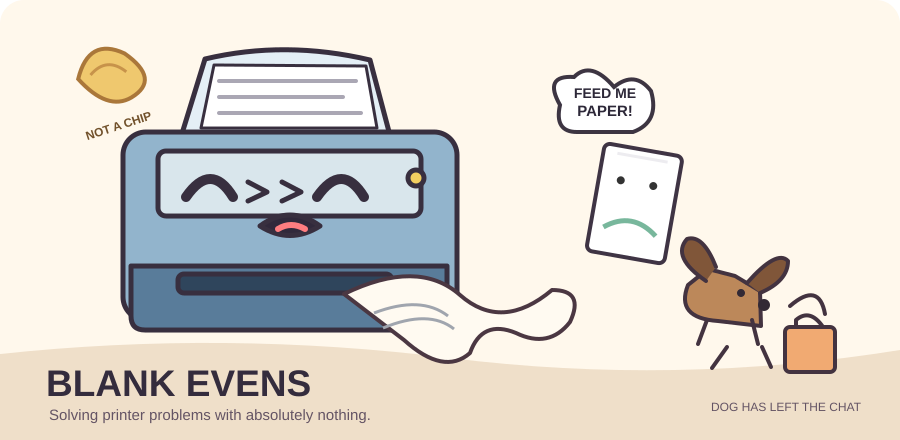

# blank-evens

**Making printers print properly by giving them twice as much nothing to print.**

PDF works with Python alone.
Word and PowerPoint work when Microsoft Office or LibreOffice can render them to PDF first.



## Anti-Pringles Technology is Finally Here!

Do you have one of those old and stupidly large **LASER PRINTERS** that look like the monolith from *2001: A Space Odyssey* and also **CURL YOUR PAGES** like freaking Pringles?

Except those aren't delicious potato chips.
Those are important legal and financial documents that you need in order to remain a functioning member of society!

And for some inexplicable reason, your printer only produces legible text when printing double-sided, but your bank demands single-sided documents because apparently everybody is in on it.

Well, fear no more!
`blank-evens` inserts a blank page after every page of a PDF, or after every page of a Word document or PowerPoint presentation once that file has been rendered to PDF, so you can trick your printer into doing its one job.

Print the new file duplex.
Each sheet should come out with your page on the front and nothing on the back.

Print your documents before the utility company cuts you off, your wife leaves you, your dog files for emancipation and/or euthanasia (not necessarily in that order), and you're left sitting in the dark eating actual Pringles while contemplating the engineering decisions behind a 2012 HP LaserJet.

**Because sometimes the solution to a printing problem is printing absolutely nothing.**

## What it does

The tool reads a document and writes a new PDF beside it.
It does not modify the file you handed it.
Odd pages in the result are your original pages, in order.
Even pages are blank and use the same size, orientation, and page boxes as the page before them.
`document.pdf` becomes `document_blank_evens.pdf`.
If that name is already there, the next file is `document_blank_evens_2.pdf`, then `_3`, and so on.
Nothing is overwritten.

An HP LaserJet Pro 400 Color MFP M475dn produced pale text in simplex and readable text on both sides in duplex.
The bank wanted single-sided pages.
Printing the blank-even PDF duplex is the workaround.
Test it on the actual printer.
Some drivers skip a page that is truly empty.

## Supported formats

| Format     | Support                                                         |
| ---------- | --------------------------------------------------------------- |
| PDF        | Working, and Office is not required.                            |
| Word       | `.doc` and `.docx`, after Word or LibreOffice renders a PDF.    |
| PowerPoint | `.ppt` and `.pptx`, one slide per PDF page, then a blank.       |
| Excel      | Out of scope, because printed sheets are not a page sequence.   |

LibreOffice conversion is covered by tests when `soffice` is installed.
The Windows Word and PowerPoint exporters use Office COM through `pywin32`.
That path is in the program, and it was not run on a Windows machine with Office installed.

Legacy `.doc` and `.ppt` use the same converters.
They are supported only when that converter accepts the file.

## Installation

Python 3.11 or newer is required.
Processing stays on your machine.

### Windows

Double-click `install_windows.bat`.
If Python 3.11+ is missing, the installer uses `winget` to install Python 3.13 for the current user, without an administrator account.
It then creates `.venv` and installs this program and `pypdf`.
It also tries to install `pywin32` so Word and PowerPoint export can run when Office is installed.
PDF files do not need Office or `pywin32`.

Drag documents onto `blank_evens_in_pdf.bat`.
Paths with spaces are passed as whole arguments.

### macOS

Double-click `install_macos.command`.
The installer uses a Python 3.11+ that is already on the Mac, Homebrew's `python@3.13` when Homebrew is installed, or the official Python 3.13 package from python.org.
The python.org package asks for an administrator password.
The installer then creates `.venv` and installs `pypdf`.

Drop documents onto `blank_evens.command`, or use the terminal:
```bash
./blank_evens.sh document.pdf
```

Word and PowerPoint on a Mac need LibreOffice (`soffice` on `PATH`) or a Windows machine with Office.
This project does not automate macOS Office.

### Linux
```bash
python3 -m venv .venv
.venv/bin/python -m pip install .
./blank_evens.sh document.pdf
```

Install LibreOffice when you want `.docx` or `.pptx` input.
PDF input does not need it.

## Usage
```bash
python blank_evens.py document.pdf
python blank_evens.py -o ./out a.pdf b.docx slides.pptx
blank-evens --help
```

More than one file is allowed.
A problem in one file does not stop the others.
The process exits `0` when every file works, `1` when no file was given, and `2` when any file fails.
Word and PowerPoint rendering happens in a temporary directory, and those temporary PDFs are removed afterward.

## Printing settings

Print `*_blank_evens.pdf` in duplex.
The front of each sheet is an original page.
The back is the blank page that was inserted after it.
Long-edge and short-edge binding depend on whether the page is portrait or landscape.
Print a two-page source before a long job and check that the backs are empty.
If the backs never appear, the driver is probably discarding blank pages.
Turn that setting off.
A tiny mark on the even pages is a possible future opt-in, not the default, because a bank may reject the mark.

## Limitations

Rewriting a PDF invalidates a digital signature.
Use the original file for electronic filing, and use the blank-even PDF for paper.
Word's pagination is dynamic.
LibreOffice and Word can disagree on fonts, line breaks, comments, tracked changes, and page breaks.
PowerPoint export is one slide per PDF page.
The tool does not write an editable `.pptx` or `.docx`.
Password-protected Office files need the password removed first.
Signed Office files lose that signature when they are exported.

On the PDF path, `pypdf` keeps the page content, the info dictionary (title and author), bookmarks, annotations, and text form fields that it is able to copy.
Those stay on the original pages.
The blank reverse gets the media, crop, trim, bleed, and art boxes, plus rotation and user unit, and it has no content stream and no annotations.
Optional content, JavaScript, embedded files, logical structure, and XMP are not promised.
If `pypdf` drops them, this tool drops them too.

## Contributing

Generate synthetic files in the tests.
Do not commit bank documents, personal documents, or other real PDFs.
```bash
python3 -m venv .venv
.venv/bin/python -m pip install ".[dev]"
.venv/bin/python -m pytest
.venv/bin/python -m ruff check .
```

`ruff` checks for real mistakes.
The portrait Python style used in this repo is not what `ruff format` emits, so formatting is not part of the check.
